# Dokumentasi Teknis & Panduan Penggunaan Website P2B UIN Salatiga

Dokumen ini merupakan panduan teknis lengkap dan tutorial operasional untuk aplikasi web resmi **Pusat Pengembangan Bisnis (P2B) Universitas Islam Negeri (UIN) Salatiga** — unit pengelola optimalisasi aset, layanan komersial, kemitraan strategis, tarif layanan PTN BLU, program magang mahasiswa, dan publikasi berita kelembagaan.

---

## Daftar Isi

1. [Gambaran Umum & Arsitektur Teknis](#1-gambaran-umum--arsitektur-teknis)
2. [Struktur Direktori & Berkas Proyek](#2-struktur-direktori--berkas-proyek)
3. [Instalasi, Environment Variables & Deployment](#3-instalasi-environment-variables--deployment)
4. [Skema Basis Data (MariaDB / MySQL)](#4-skema-basis-data-mariadb--mysql)
5. [Fitur Website Publik (Frontend)](#5-fitur-website-publik-frontend)
6. [Autentikasi Better Auth & Profil Peran (RBAC)](#6-autentikasi-better-auth--profil-peran-rbac)
7. [Panduan Lengkap Panel CMS (`/cms`)](#7-panduan-lengkap-panel-cms-cms)
8. [Referensi API Endpoints & WebSocket](#8-referensi-api-endpoints--websocket)
9. [Rencana Pengembangan Ke Depan (Roadmap)](#9-rencana-pengembangan-ke-depan-roadmap)
10. [Indeks Gambar Tutorial](#10-indeks-gambar-tutorial)

---

## 1. Gambaran Umum & Arsitektur Teknis

Aplikasi dibangun dengan arsitektur **Full-Stack Monolith (SPA + REST API + WebSocket)** yang berjalan pada satu server Node.js/Express di port `3000`.

### Stack Teknologi

| Lapisan | Teknologi | Peran Utama |
| :--- | :--- | :--- |
| **Frontend UI** | React 19, TypeScript, Vite 8 | Antarmuka pengguna SPA & panel CMS |
| **Styling & Animasi** | Tailwind CSS v4, Motion (`motion/react`), GSAP (`ScrollTrigger`) | Desain responsif, parallax, animasi gulir |
| **Ikon & Editor** | `@iconify/react` (`mdi`), `lucide-react`, TinyMCE 8, DOMPurify | Ikon UI & editor berita WYSIWYG ter-sanitasi |
| **Peta Interaktif** | Leaflet (`leaflet`) | Peta lokasi Gedung Auditorium & kampus |
| **Backend Server** | Express 4 (`server.ts`), `tsx`, Multer, WebSocket (`ws`) | Proxy API, upload file, SSR metadata/SEO, real-time sync |
| **Autentikasi & RBAC** | **Better Auth v1.7** (`username`, `admin`, `bearer` plugins) | Sesi `HttpOnly` cookie, Bearer token in-memory, peran akses |
| **Database** | MariaDB / MySQL (`mysql2/promise` pool) | Penyimpanan konten CMS, media blob, akun, lamaran magang |

### Pola Sinkronisasi & Performa
- **Server Bootstrap (`/api/public/bootstrap`)**: Mengambil seluruh konfigurasi publik (pengaturan situs, blok Page Builder, berita, kategori, logo mitra, galeri/posisi magang, daftar tarif layanan) dalam satu permintaan terstruktur, lengkap dengan fallback default bawaan apabila database sedang tidak tersedia.
- **Sinkronisasi Real-Time (`useRealtimeSync`)**: Klien terhubung melalui **WebSocket (`/ws/realtime`)** dan cadangan *version polling* (`/api/public/version` setiap 15 detik + saat tab aktif kembali). Setiap perubahan di CMS langsung memancarkan event `cms:committed` sehingga pengunjung melihat pembaruan tanpa muat ulang manual.
- **Keamanan Sanitasi**: Seluruh HTML artikel dari TinyMCE disanitasi menggunakan **DOMPurify**, dan setiap URL tautan/media/PDF melewati validasi protokol aman (`http:`, `https:`, `/api/media/...`, atau path lokal valid).

---

## 2. Struktur Direktori & Berkas Proyek

```text
.
├── server.ts                       # Entry point Express, Vite middleware, REST API, WebSocket, & auto-migrasi DB
├── index.html                      # Entry HTML + meta default
├── metadata.json                   # Identitas & kapabilitas aplikasi
├── package.json                    # Script (dev, build, start, lint) & dependensi
├── .env.example                    # Template variabel lingkungan
├── public/
│   └── assets/                     # Aset statis publik (gambar magang, PDF SK Organisasi, PDF Tarif, dll.)
├── docs/
│   ├── README.md                   # Dokumentasi teknis & panduan pengguna ini
│   └── images/                     # Folder tempat menyimpan screenshot tutorial dokumentasi
└── src/
    ├── App.tsx                     # Router SPA publik, rute tersembunyi /silahkanmasuk & /cms, SEO per halaman
    ├── auth.ts                     # Konfigurasi server Better Auth, migrasi tabel, & aktivasi Super Admin awal
    ├── db/
    │   └── pool.ts                 # Pool koneksi MariaDB/MySQL (mysql2/promise)
    ├── lib/
    │   ├── authRoles.ts            # Definisi Access Control (cmsAc) & 3 peran: super_admin, admin, editor_berita
    │   ├── authClient.ts           # Client Better Auth React + Bearer token di memori JS (tanpa localStorage)
    │   └── gsap.ts                 # Registrasi plugin GSAP & ScrollTrigger
    ├── hooks/
    │   └── useRealtimeSync.ts      # Hook sinkronisasi WebSocket + polling versi data publik
    ├── types/
    │   └── cms.ts                  # Definisi tipe TypeScript seluruh entitas CMS & domain publik
    ├── utils/
    │   └── seo.ts                  # Helper dinamis title, meta description, OpenGraph, canonical, & JSON-LD
    ├── data/
    │   ├── defaultNav.ts           # Struktur menu navigasi default
    │   ├── homeBuilderDefaults.ts  # Katalog 19 blok Page Builder & susunan bawaan Beranda + 3 halaman Profil
    │   ├── kerjasamaDefaults.ts    # Konfigurasi default Google Sheets CSV & fungsi parser tanggal/sorting
    │   ├── magangDefaults.ts       # Data default galeri, posisi magang, fakultas, & benefit
    │   ├── news.ts                 # Data awal berita & kategori berita
    │   └── tarifDefaults.ts        # Kategori tarif layanan default & resolver PDF/Google Drive
    └── components/
        ├── Navbar.tsx              # Header mengambang responsif, dropdown dinamis, & modal Kontak/Layanan
        ├── Footer.tsx              # Footer utama dengan tautan cepat & identitas P2B
        ├── Hero.tsx                # Hero layar penuh Beranda dengan GSAP parallax & pojok faux-cutout
        ├── PageHero.tsx            # Hero halaman sekunder (Profil, Kerjasama, Tarif, Magang, Berita)
        ├── HomePageRenderer.tsx    # Mesin render Page Builder untuk Beranda & halaman Profil
        ├── HomePageBuilderPanel.tsx# Antarmuka visual Page Builder di dalam CMS
        ├── WhoWeAre.tsx            # Seksi Tentang P2B & Kartu Fokus interaktif
        ├── VisiCard.tsx            # Kartu Visi Kelembagaan bernuansa zamrud
        ├── OrgChartSection.tsx     # Bagan Struktur Organisasi & penampil/unduh SK Rektor
        ├── NewsSection.tsx         # Seksi Berita terbaru di halaman utama
        ├── AllNewsPage.tsx         # Halaman arsip semua berita + pencarian & filter kategori
        ├── NewsDetailPage.tsx      # Halaman baca berita lengkap + galeri foto + lampiran PDF
        ├── EditorialNewsCard.tsx   # Kartu artikel berita editorial
        ├── LocationSection.tsx     # Peta interaktif Leaflet & kartu alamat kantor P2B
        ├── LogoMarqueeSection.tsx  # Marquee berjalan logo mitra & unit usaha
        ├── KerjasamaPage.tsx       # Halaman tabel Kerjasama & Sewa Aset terintegrasi Google Sheets CSV
        ├── TarifLayananPage.tsx    # Halaman Tarif Layanan dinamis dengan PDF Viewer (Drive & lokal)
        ├── MagangPage.tsx          # Halaman informasi program Magang, galeri, & lowongan posisi
        ├── MagangRegisterPage.tsx  # Formulir pendaftaran magang + upload CV & Portofolio PDF
        ├── CmsLoginPage.tsx        # Halaman login (/silahkanmasuk) & aktivasi Super Admin pertama
        ├── CmsDashboard.tsx        # Panel utama CMS (semua modul manajemen konten)
        ├── CmsUsersPanel.tsx       # Manajemen pengguna, peran, ban/unban, & reset password (Super Admin)
        ├── TinyMceEditor.tsx       # Integrasi WYSIWYG editor untuk isi berita
        ├── BottomRightCorner.tsx   # Komponen tombol pojok kanan-bawah khas Hero
        ├── CardCornerPattern.tsx   # Ornamen pola sudut SVG pada kartu
        ├── ScrollWordTitle.tsx     # Animasi kemunculan judul per kata
        └── NotFoundPage.tsx        # Halaman 404 dengan navigasi kembali ke beranda/berita
```

---

## 3. Instalasi, Environment Variables & Deployment

### Prasyarat
- Node.js `>= 20.x` (atau Bun)
- Server **MariaDB / MySQL** yang dapat diakses dari server aplikasi

### Konfigurasi `.env`
Salin `.env.example` menjadi `.env` (atau atur di Secrets Manager pada platform deploy):

| Variabel | Wajib | Keterangan |
| :--- | :---: | :--- |
| `DB_HOST` | Ya | Hostname / IP server MariaDB (contoh: `localhost` atau host tunnel) |
| `DB_PORT` | Ya | Port database (default `3306`, atau port tunnel yang dikonfigurasi) |
| `DB_USER` | Ya | Username database MariaDB |
| `DB_PASSWORD` | Ya | Password database MariaDB |
| `DB_NAME` | Ya | Nama schema database (default `p2b`) |
| `BETTER_AUTH_SECRET` | Disarankan | Kunci acak minimal 32 karakter untuk menandatangani token sesi Better Auth |
| `CMS_SESSION_SECRET` | Opsional | Fallback secret apabila `BETTER_AUTH_SECRET` belum diisi |
| `APP_URL` | Disarankan | URL publik penuh aplikasi (mis. `https://pusatbisnis.uinsalatiga.ac.id`) |
| `CMS_ADMIN_PASSWORD` | Opsional | Jika diisi saat DB kosong, server otomatis membuat akun `admin` (`super_admin`) |
| `PORT` | Opsional | Port server HTTP (default `3000`) |

### Perintah Pengembangan & Produksi

```bash
# 1. Instal dependensi
npm install

# 2. Jalankan mode development (Express + Vite middleware di port 3000)
npm run dev

# 3. Validasi TypeScript tanpa emit
npm run lint

# 4. Build aset produksi frontend (menghasilkan folder dist/)
npm run build

# 5. Jalankan server produksi (menyajikan API + static build dari dist/)
npm start
```

---

## 4. Skema Basis Data (MariaDB / MySQL)

Saat startup, `server.ts` dan `src/auth.ts` menjalankan inisialisasi skema secara idempoten (`CREATE TABLE IF NOT EXISTS` dan migrasi Better Auth `getMigrations`).

### A. Tabel Autentikasi (Better Auth)
1. **`user`**: Menyimpan akun pengelola (`id`, `name`, `email`, `username`, `displayUsername`, `role`, `banned`, `banReason`, `banExpires`, `createdAt`, `updatedAt`).
2. **`session`**: Menyimpan sesi aktif & masa kedaluwarsa (`12 jam`, pembaruan otomatis tiap `1 jam`).
3. **`account`**: Menyimpan kredensial ter-hash (`scrypt` bawaan Better Auth maupun dukungan verifikasi `bcrypt` hasil migrasi tabel lama).
4. **`verification`**: Token verifikasi standar Better Auth.

> *Catatan Migrasi*: Jika masih terdapat tabel lama `cms_users`, sistem otomatis memigrasikan akun-akun tersebut ke tabel Better Auth `user` & `account` pada saat startup.

### B. Tabel Konten & Operasional CMS
1. **`cms_home_blocks`**: Menyimpan susunan blok Page Builder lintas halaman (`page_slug`: `home`, `about`, `visi-misi`, `struktur-organisasi`), `block_type`, `label`, `config_json`, `sort_order`, `is_visible`.
2. **`cms_builder_presets`**: Katalog preset elemen kustom yang dibuat pengguna dan otomatis terdaftar untuk digunakan ulang di halaman mana pun.
3. **`cms_news`**: Artikel berita (`slug`, `title`, `category`, `date_label`, `excerpt`, `content_html`, `image_url`, `gallery_json`, `attachments_json`, `is_published`, `sort_order`).
4. **`cms_news_categories`**: Kategori berita dinamis (`name`, `sort_order`).
5. **`cms_media`**: Media Library terpusat (`id` UUID, `original_name`, `alt_text`, `mime_type`, `size_bytes`, `file_data` `LONGBLOB`) untuk gambar dan PDF.
6. **`cms_partner_logos`**: Logo mitra & unit usaha pada seksi Marquee.
7. **`cms_tarif_items`**: Daftar kategori Tarif Layanan dinamis (`slug`, `nav_label`, `short_label`, `title`, `doc_number`, `description`, `pdf_url`, `sort_order`, `is_active`).
8. **`cms_magang_gallery`**: Dokumentasi foto kegiatan mahasiswa magang.
9. **`cms_magang_positions`**: Daftar formasi magang (`title`, `division`, `description`, `image_url`, `tasks_json`, `is_available`, `is_active`, `sort_order`).
10. **`cms_magang_applications`**: Data pendaftar magang beserta status seleksi (`baru`, `ditinjau`, `diterima`, `ditolak`) dan referensi file CV/portofolio.
11. **`cms_magang_applicant_files`**: Penyimpanan biner (`LONGBLOB`) dokumen PDF CV dan Portofolio pelamar magang.
12. **`cms_site_settings`**: Key-value store pengaturan global (Hero halaman Kerjasama, Hero Tarif, sumber CSV Google Sheets, kontak telepon/WA/email, koordinat lokasi).

---

## 5. Fitur Website Publik (Frontend)

### 5.1 Beranda (`/`) & Tata Letak Khas P2B
- **Hero Layar Penuh**: Menampilkan gambar latar beranimasi parallax GSAP, judul bertahap per kata (`ScrollWordTitle`), deskripsi ringkas, dan tombol sudut kanan-bawah berbentuk *faux-cutout* (`BottomRightCorner`).
- **Marquee Logo Mitra**: Barisan logo UIN Salatiga, unit bisnis, dan mitra eksternal yang berjalan mulus tanpa putus.
- **Tentang P2B & Kartu Fokus (`WhoWeAre`)**: Penjelasan peran PTN BLU disertai kartu fokus interaktif yang membuka detail poin unggulan saat diklik.
- **Visi Kelembagaan (`VisiCard`)**, **News & Update** (3 berita terbaru dengan kartu editorial), **Peta Interaktif Leaflet**, dan **Footer**.

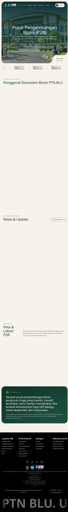
> *Gambar 01 — Tangkapan layar halaman Beranda (`/`) di `docs/images/01-beranda-publik.png`.*

---

### 5.2 Navigasi Header, Layanan & Kontak (`Navbar.tsx`)
- **Perilaku Cerdas**: Header mengambang (*floating glassmorphism*) yang bersembunyi otomatis saat halaman digulir ke bawah dan muncul kembali ketika pengguna menggulir ke atas.
- **Menu Profil**: Dropdown menuju `/tentang-kami`, `/visi-misi`, dan `/struktur-organisasi`.
- **Menu Tarif Layanan**: Dropdown **otomatis mengikuti daftar aktif** dari database `cms_tarif_items` (tidak lagi terbatas statis).
- **Menu Layanan**: Menampilkan dropdown layanan komersial (**Air Mineral**, **Pelayanan Sewa Aset**, **Klinik UIN SAGA**, **Kantin**, **Tiket**) yang membuka modal informasi layanan. *(Opsi Gedung Auditorium telah dihapus dari daftar ini sesuai penyesuaian operasional).*
- **Tombol Kontak**: Membuka modal informasi kontak resmi (Telepon, WhatsApp langsung `wa.me`, Email `p2b@uinsalatiga.ac.id`, dan Alamat lengkap).

---

### 5.3 Halaman Profil Kelembagaan (Terkoneksi Page Builder)
Ketiga halaman profil dapat disusun ulang, ditambah elemen baru, atau diedit per blok melalui CMS Page Builder:
1. **Tentang Kami (`/tentang-kami`)**: `PageHero`, narasi profil 2 kolom (`about_intro`), galeri foto ganda (`dual_banners`), dan 4 prinsip tata kelola BLU (`governance_values`).
2. **Visi & Misi (`/visi-misi`)**: `PageHero`, `VisiCard`, dan grid 5 fokus misi strategis (`misi_grid`).
3. **Struktur Organisasi (`/struktur-organisasi`)**: `PageHero`, bagan struktur organisasi sesuai **SK Rektor UIN Salatiga Nomor 56 Tahun 2026** lengkap dengan penampil/tautan unduh PDF SK (`org_chart`), serta grid 4 ruang lingkup unit usaha (`unit_divisions`).

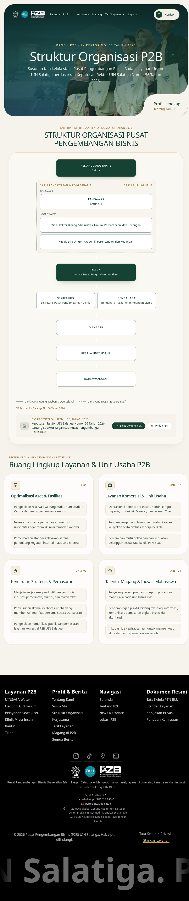
> *Gambar 02 — Tangkapan layar halaman `/struktur-organisasi` atau `/tentang-kami` di `docs/images/02-halaman-profil-struktur.png`.*

---

### 5.4 Berita & Update (`/semua-berita` & `/berita/:slug`)
- **Halaman Arsip (`/semua-berita`)**: Filter berdasarkan kategori berita dan kotak pencarian judul/ringkasan secara real-time.
- **Halaman Detail (`/berita/:slug`)**:
  - Konten artikel berformat kaya (heading, tabel, daftar, kutipan, tautan) yang aman dari XSS.
  - Galeri foto dokumentasi tambahan dengan keterangan gambar (*caption*) dan mode perbesar (*lightbox*).
  - Daftar **Lampiran Dokumen PDF** yang bisa dilihat langsung atau diunduh.
  - Rekomendasi berita terkait di bagian bawah.

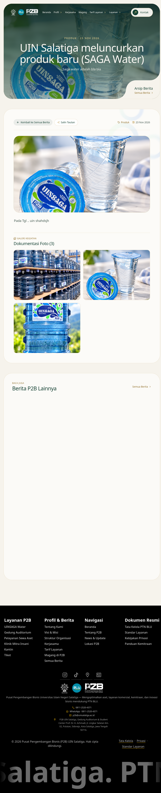
> *Gambar 03 — Tangkapan layar halaman detail berita di `docs/images/03-berita-detail.png`.*

---

### 5.5 Kerjasama & Sewa Aset (`/kerjasama`)
- **Sinkronisasi Google Sheets (Publish-to-Web CSV)**: Server melakukan fetch & parsing CSV dari tautan Google Sheets yang diatur di CMS (default: Sheet BPK), mendukung struktur header bertingkat:
  - `Nama Penyewa`
  - `Masa Sewa/Kerjasama` (`Mulai` & `Selesai`)
  - `Perihal`
  - `Jenis`
  - `Berkas`
- **Pencarian, Filter & Pengurutan (Sorting)**:
  - Filter cepat berdasarkan kategori `Jenis` kerjasama/sewa.
  - Pencarian kata kunci pada nama penyewa maupun perihal.
  - **Pengurutan multi-arah (Asc/Desc)** berdasarkan **Urutan Asli**, **Jenis**, **Tanggal Mulai**, **Tanggal Selesai** (mengenali format tanggal Indonesia maupun Inggris seperti `"31 Jan 2024"`, `"3 Februari 2025"`, ISO, DD/MM/YYYY), dan **Nama Penyewa**.
- **Akses Berkas Perjanjian**: Kolom `Berkas` ditampilkan sebagai tombol ikon dokumen yang langsung mengarahkan ke tautan dokumen berkas apabila tersedia.
- **Hero Dinamis**: Gambar latar, eyebrow, judul, subjudul, dan teks pojok kanan-bawah dapat diatur dari CMS.

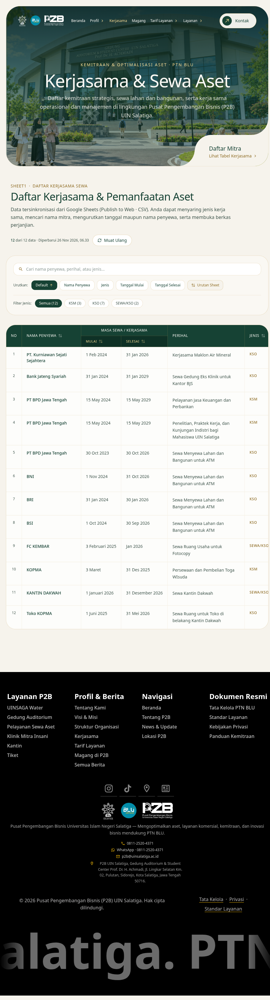
> *Gambar 04 — Tangkapan layar halaman `/kerjasama` di `docs/images/04-halaman-kerjasama.png`.*

---

### 5.6 Tarif Layanan (`/tarif-layanan/:slug`)
- **Tab Kategori Dinamis**: Menampilkan seluruh kategori tarif aktif dari database (secara bawaan: *Tarif Layanan Penunjang Akademik — SK Rektor No. 29 Tahun 2024*, *Tarif Layanan Klinik Mitra Insani*, dan *Tarif Jurnal*, serta kategori tambahan apa pun yang dibuat dari CMS).
- **PDF Viewer Terintegrasi**:
  - Jika sumber berupa link **Google Drive** (`/file/d/<ID>/view`), aplikasi otomatis mengonversinya ke URL `/preview` agar tampil di dalam viewer dan menyediakan tombol buka tab baru & unduh.
  - Jika sumber berupa berkas **PDF Media Library (`/api/media/...`)** atau PDF lokal (`public/assets/...`), langsung ditampilkan pada iframe/object PDF viewer lengkap dengan tombol unduh.
  - Dilengkapi fallback PDF lokal untuk *Tarif Layanan Penunjang Akademik* apabila sumber utama belum dimuat.

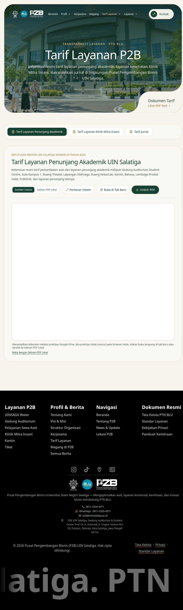
> *Gambar 05 — Tangkapan layar halaman `/tarif-layanan/penunjang-akademik` di `docs/images/05-tarif-layanan-pdf-viewer.png`.*

---

### 5.7 Program Magang P2B (`/magang` & `/magang/daftar`)
- **Halaman Informasi (`/magang`)**:
  - Galeri aktivitas mahasiswa magang.
  - Daftar posisi/divisi yang dikelola CMS (contoh: *Content Creator*, *Graphic Designer*, *Office Administrator*), lengkap dengan badge status ketersediaan (**Dibuka** / **Penuh**), deskripsi, dan rincian tugas.
  - Daftar benefit program magang.
- **Formulir Pendaftaran (`/magang/daftar`)**:
  - Pengisian data mahasiswa (Nama, Email, No. HP/WA, Fakultas UIN Salatiga, Program Studi, Pengenalan P2B, Pilihan Posisi yang tersedia, Alasan minat, Harapan).
  - Unggah berkas wajib **CV / Resume (PDF)** dan opsional **Portofolio (PDF)**.
  - Setelah berhasil dikirim (`POST /api/public/magang/apply`), pelamar langsung mendapatkan **Kode Registrasi** unik (contoh: `P2B-MGG-2026...`).

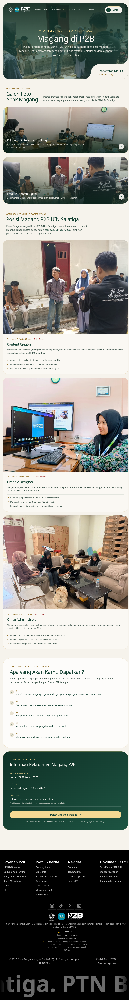
> *Gambar 06 — Tangkapan layar halaman `/magang` atau `/magang/daftar` di `docs/images/06-halaman-magang-daftar.png`.*

---

## 6. Autentikasi Better Auth & Profil Peran (RBAC)

Sistem autentikasi CMS menggunakan **Better Auth** (`/src/auth.ts`, `/src/lib/authRoles.ts`, `/src/lib/authClient.ts`) yang diproteksi di rute tersembunyi `/silahkanmasuk`.

### 6.1 Alur Aktivasi & Masuk
1. **Aktivasi Pertama Kali**: Apabila tabel `user` di database masih kosong dan `CMS_ADMIN_PASSWORD` tidak ditetapkan di `.env`, halaman `/silahkanmasuk` otomatis menampilkan formulir **Buat Akun Super Admin** pertama (`POST /api/auth-setup/claim`). Setelah satu akun terdaftar, endpoint aktivasi ini otomatis terkunci (`409 Conflict`).
2. **Login Standar**: Pengguna dapat masuk memakai **Username** atau **Email** beserta password. Token sesi dikirim melalui `HttpOnly` cookie sekaligus `Bearer` token di memori JavaScript untuk kompatibilitas lingkungan proxy/iframe.

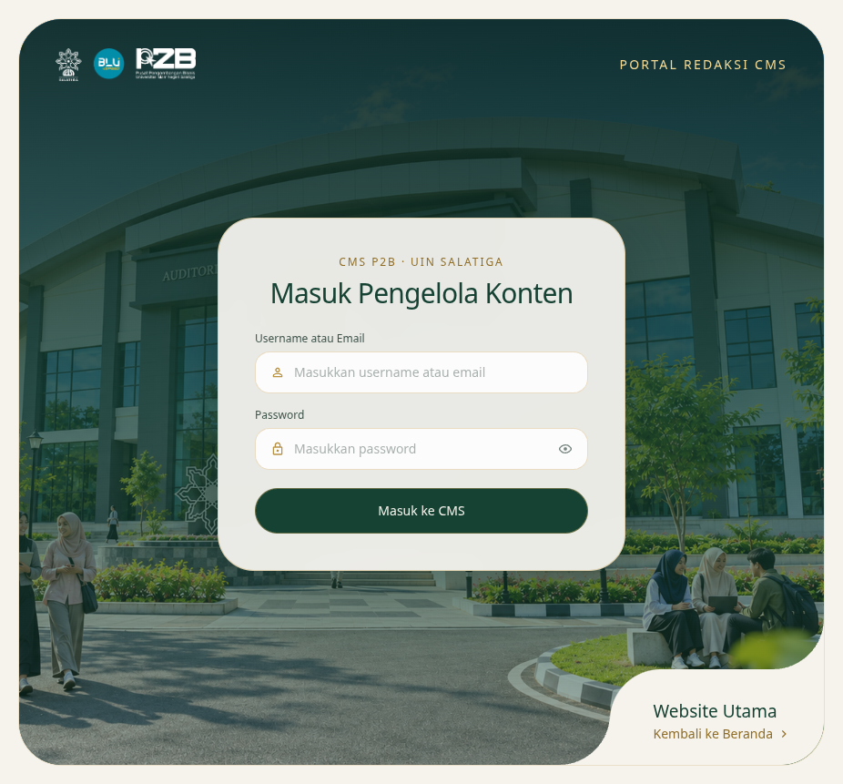
> *Gambar 07 — Tangkapan layar halaman `/silahkanmasuk` di `docs/images/07-login-cms.png`.*

### 6.2 Matriks Profil Peran (3 Peran)

| Fitur / Modul CMS | Super Admin (`super_admin`) | Admin (`admin`) | Editor Berita (`editor_berita`) |
| :--- | :---: | :---: | :---: |
| **Ringkasan & Status Database** | Ya | Ya | Ya (Ringkasan berita) |
| **Page Builder (Beranda & Profil)** | Ya | Ya | Tidak |
| **Kelola Berita & Kategori Berita** | Ya | Ya | Ya |
| **Unggah Foto/PDF di Editor Berita** | Ya | Ya | Ya |
| **Media Library (Lihat / Edit / Hapus / Export-Import)** | Ya (Penuh) | Ya (Penuh) | Baca & Pakai Media |
| **Logo Mitra** | Ya | Ya | Tidak |
| **Kerjasama (Google Sheets CSV & Hero)** | Ya | Ya | Tidak |
| **Tarif Layanan (CRUD Kategori & PDF)** | Ya | Ya | Tidak |
| **Magang P2B (Galeri, Posisi & Pendaftar)** | Ya | Ya | Tidak |
| **Pengaturan Situs & Kontak** | Ya | Ya | Tidak |
| **Manajemen Pengguna, Peran & Reset Password** | **Ya (Eksklusif)** | Tidak | Tidak |
| **Ubah Password Akun Sendiri** | Ya | Ya | Ya |

---

## 7. Panduan Lengkap Panel CMS (`/cms`)

Setelah berhasil masuk, pengguna diarahkan ke `/cms`. Tab yang tampil pada sidebar/navigasi CMS otomatis menyesuaikan izin peran akun yang login.

### 7.1 Tab Ringkasan (`overview`)
Menampilkan jumlah total berita, berita terbit, status koneksi MariaDB (host, port, nama database, versi), serta pintasan menuju modul kerja yang diizinkan.

---

### 7.2 Tab Page Builder (`homebuilder`)
Modul *visual page builder* terintegrasi database untuk mengatur halaman **Beranda (`/`)** maupun **3 halaman Profil (`/tentang-kami`, `/visi-misi`, `/struktur-organisasi`)**:

1. **Pilih Halaman Target**: Beralih antar halaman *Beranda*, *Tentang Kami*, *Visi & Misi*, atau *Struktur Organisasi*.
2. **Edit Per Elemen**: Klik ikon edit pada setiap blok untuk mengubah teks, gambar (upload/Media Library), tautan CTA, hingga item berulang (kartu fokus, nilai tata kelola, poin misi, divisi unit usaha, statistik).
3. **Tambah Elemen & Auto-Registrasi Katalog**:
   - Pilih dari **19 tipe blok proyek bawaan**: `hero`, `page_hero`, `logo_marquee`, `who_we_are`, `about_intro`, `dual_banners`, `governance_values`, `visi_card`, `misi_grid`, `org_chart`, `unit_divisions`, `news_updates`, `location_map`, `magang_gallery`, `magang_positions`, `editorial_split`, `feature_cards`, `cta_banner`, `stats_row`.
   - Ketika membuat elemen kustom baru, pengguna dapat mencentang opsi penyimpanan ke **Katalog Preset** (`cms_builder_presets`) sehingga elemen baru tersebut otomatis terdaftar untuk dipakai ulang di halaman lain.
4. **Duplikat & Salin Lintas Halaman**: Gandakan blok di halaman yang sama atau salin blok beserta seluruh konfigurasinya ke halaman Profil/Beranda lain.
5. **Atur Urutan, Tampil/Sembunyikan, Hapus & Reset**: Geser urutan naik/turun, nonaktifkan sementara tanpa menghapus (`isVisible`), atau kembalikan halaman ke susunan bawaan.

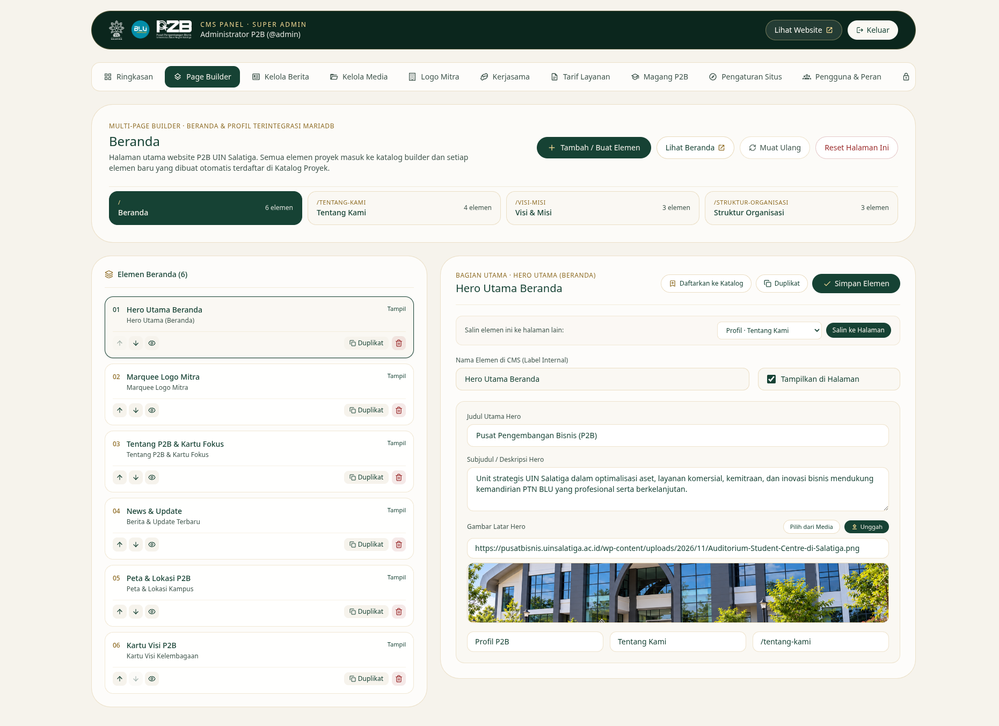
> *Gambar 08 — Tangkapan layar tab Page Builder (`/cms`) di `docs/images/08-cms-page-builder.png`.*

---

### 7.3 Tab Kelola Berita & Kategori (`news`)
- **Editor Berita**: Input judul, slug URL otomatis/kustom, kategori, tanggal tampil, status (*Terbit* / *Draft*), ringkasan, isi lengkap dengan **TinyMCE**, gambar sampul utama (upload atau pilih dari Media Library), **galeri foto tambahan**, dan **lampiran dokumen PDF**.
- **Kategori Berita**: Tambah, ubah nama, atur urutan, dan hapus kategori (artikel terkait tetap aman).
- **Aksi Massal & Portabilitas**: Pencarian berita, seleksi banyak (*checkbox*) untuk hapus massal, serta **Export/Import Bundle JSON** berita untuk pencadangan atau migrasi antar server.

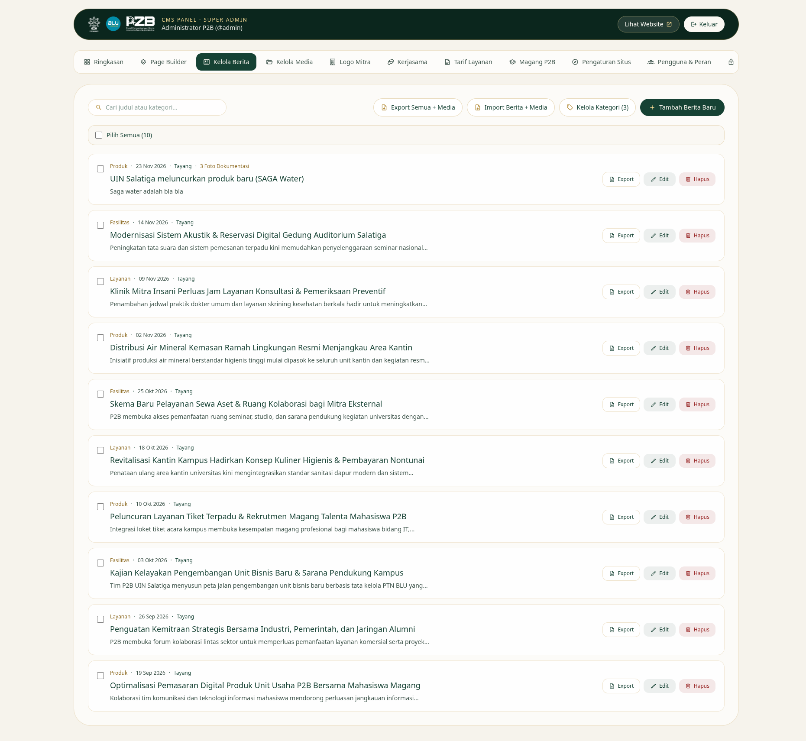
> *Gambar 09 — Tangkapan layar form editor atau daftar berita di `docs/images/09-cms-kelola-berita.png`.*

---

#### 7.3.1 Panduan Menambah Berita Baru (Langkah demi Langkah)

Berikut panduan operasional lengkap untuk menambahkan artikel berita baru melalui panel CMS:

1. **Masuk ke Panel CMS**  
   Buka `/silahkanmasuk`, masuk dengan akun yang memiliki izin **Kelola Berita** (Super Admin, Admin, atau Editor Berita), lalu pilih tab **Kelola Berita**.

2. **Buka Form Editor**  
   Klik tombol **Tambah Berita Baru** di pojok kanan atas daftar berita. Form editor akan terbuka dengan judul *Tambah Berita Baru*.

3. **Isi Judul Berita**  
   Ketik judul artikel pada kolom **Judul Berita**. Slug URL otomatis dibuat dari judul (dapat disesuaikan jika diperlukan) dan dipakai pada rute `/berita/:slug`.

4. **Isi Ringkasan Singkat**  
   Tulis ringkasan pada kolom **Ringkasan Singkat**. Teks ini tampil pada kartu berita, halaman arsip, dan pratinjau OpenGraph saat dibagikan.

5. **Tulis Isi Berita Lengkap (TinyMCE)**  
   Gunakan editor WYSIWYG TinyMCE untuk menyusun artikel: heading, paragraf, daftar bernomor/bulleted, tabel, kutipan, tautan, serta penyisipan gambar di tengah teks. Semua HTML disanitasi otomatis dengan DOMPurify sebelum tayang.

6. **Atur Foto Sampul Utama**  
   - Klik **Unggah Sampul** untuk memilih gambar dari perangkat, atau  
   - Centang **Gunakan logo placeholder UIN Salatiga** apabila belum ada foto sampul.  
   Foto sampul tampil pada kartu berita, hero halaman detail, dan OpenGraph.

7. **Tambah Galeri Dokumentasi Foto (opsional)**  
   - Klik **Unggah Banyak Foto** untuk menambahkan beberapa foto sekaligus, atau  
   - Tempel URL foto pada kolom yang tersedia lalu klik **+ Tambah URL Foto**.  
   Foto galeri tampil di halaman detail berita dengan keterangan (*caption*) dan mode perbesar (*lightbox*).

8. **Tambah Lampiran Dokumen PDF (opsional)**  
   - Klik **Unggah File PDF** untuk mengunggah berkas, atau  
   - Isi **Judul dokumen PDF** dan **URL file PDF**, lalu klik **+ Tambah PDF**.  
   Lampiran PDF tampil sebagai daftar dokumen yang dapat dilihat langsung atau diunduh pada halaman detail berita.

9. **Atur Pengaturan Publikasi**  
   - **Kategori Berita**: pilih kategori yang sesuai (atau klik **Kelola Kategori** untuk menambah/ubah/urutkan kategori).  
   - **Tanggal Upload**: otomatis terisi hari ini (dapat disesuaikan).  
   - **Publikasikan berita di website utama**: centang agar artikel langsung tayang; kosongkan untuk menyimpan sebagai *Draft*.

10. **Simpan Berita**  
    Klik tombol **Simpan Berita** di pojok kanan atas form. Artikel yang dipublikasikan langsung muncul di halaman utama (3 berita terbaru) dan arsip `/semua-berita` secara *real-time* via WebSocket, tanpa muat ulang manual.

11. **Verifikasi**  
    - Cek daftar berita pada tab **Kelola Berita** (status **Tayang** / *Draft*).  
    - Buka halaman publik `/semua-berita` atau `/berita/:slug` untuk memastikan tampilan, galeri, dan lampiran PDF benar.  
    - Gunakan fitur **Export** pada kartu berita untuk mencadangkan artikel (termasuk media) ke berkas JSON.

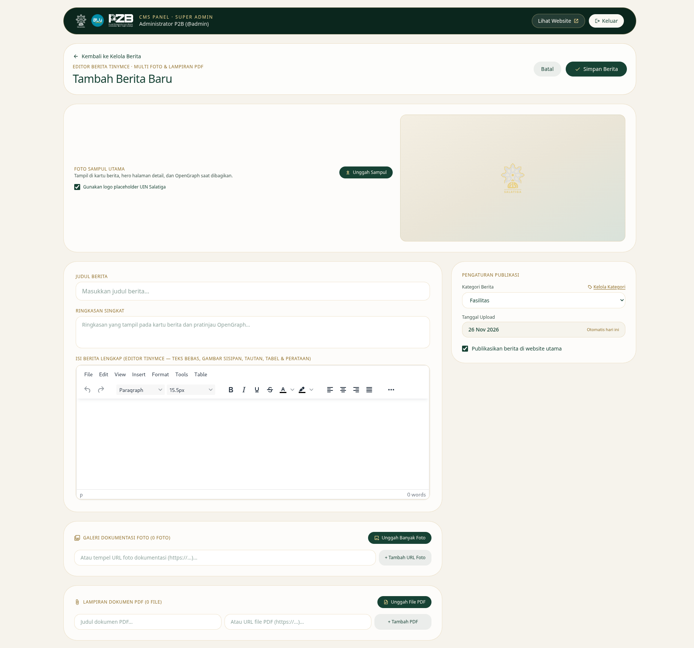
> *Gambar 15 — Tangkapan layar form *Tambah Berita Baru* (foto sampul, editor TinyMCE, galeri, lampiran PDF, & pengaturan publikasi) di `docs/images/15-cms-tambah-berita.png`.*

### 7.4 Tab Media Library (`media`)
- Mengunggah gambar (`JPG`, `PNG`, `WEBP`, `GIF`) dan dokumen `PDF` langsung ke MariaDB (`LONGBLOB`) sehingga tersedia permanen lewat `/api/media/:id/:filename`.
- Filter berdasarkan tipe (`Semua`, `Gambar`, `PDF`), pencarian nama/alt text, salin tautan URL satu klik, edit metadata atau ganti file biner tanpa mengubah URL ID, serta **Export/Import Bundle Media JSON**.

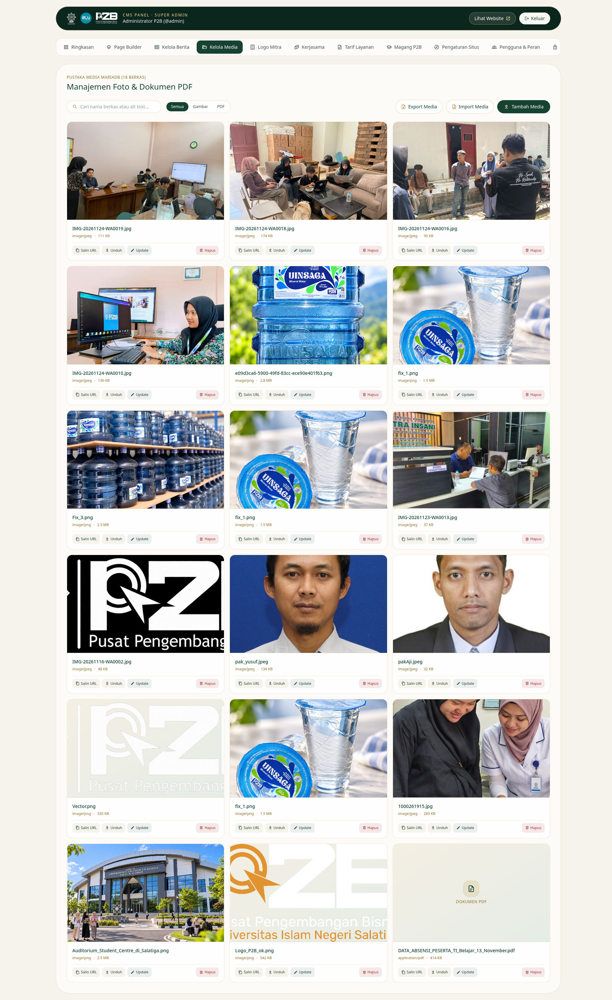
> *Gambar 10 — Tangkapan layar Media Library di `docs/images/10-cms-media-library.png`.*

---

### 7.5 Tab Logo Mitra (`logos`)
- Menambah, menyunting, mengurutkan ulang, mengaktifkan/menonaktifkan, dan menghapus logo mitra yang tampil berjalan otomatis (*marquee*) pada blok `logo_marquee`.

---

### 7.6 Tab Kerjasama (`kerjasama`)
- **Pengaturan Hero & Sumber Sheet**: Atur gambar Hero, judul, subjudul, label sheet (mis. `Sheet BPK`), serta tautan **Google Sheets Publish-to-Web (CSV)**.
- **Live Preview & Verifikasi Data**: Menampilkan pratinjau langsung tabel hasil sinkronisasi CSV (`Nama Penyewa`, `Mulai`, `Selesai`, `Perihal`, `Jenis`, ikon `Berkas`) lengkap dengan status jumlah baris dan tombol *Refresh*.

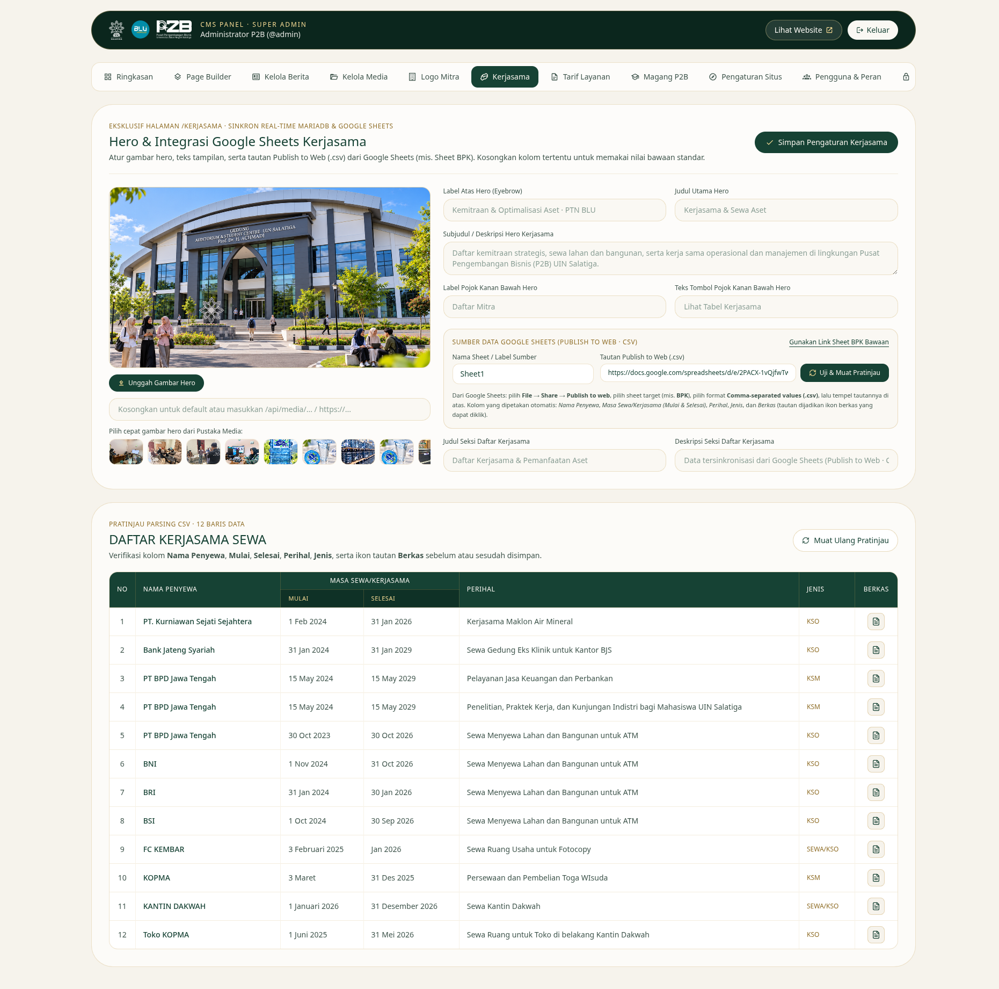
> *Gambar 11 — Tangkapan layar tab Kerjasama CMS di `docs/images/11-cms-kerjasama.png`.*

---

### 7.7 Tab Tarif Layanan (`tarif`)
- **Pengaturan Hero Tarif**: Sesuaikan gambar latar, eyebrow, judul, subjudul, dan tombol pojok halaman Tarif Layanan.
- **Manajemen Kategori Tarif Dinamis (CRUD Penuh)**:
  - Tidak lagi terbatas pada 3 item statis — Admin/Super Admin dapat **menambah kategori tarif baru**, **mengedit**, **mengurutkan ulang**, **mengaktifkan/menonaktifkan**, atau **menghapus** kategori tarif.
  - Setiap kategori mendukung input tautan **Google Drive PDF**, pemilihan berkas dari Media Library, maupun **unggah PDF langsung** dengan **Live PDF Preview** di samping form.
  - Perubahan otomatis memperbarui dropdown **Tarif Layanan** pada menu Navigasi publik.

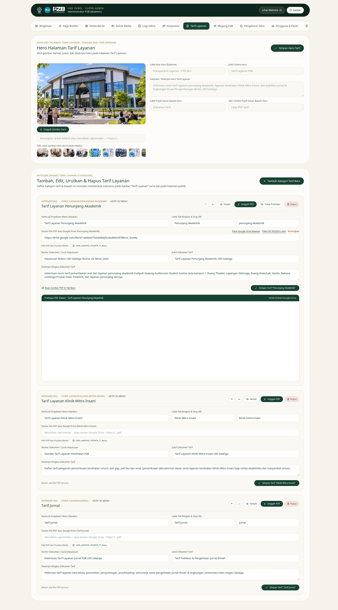
> *Gambar 12 — Tangkapan layar tab Tarif Layanan CMS di `docs/images/12-cms-tarif-layanan.png`.*

---

### 7.8 Tab Magang P2B (`magang`)
Terdiri dari 4 sub-bagian utama:
1. **Hero Magang**: Pengaturan gambar banner utama halaman `/magang`.
2. **Galeri Aktivitas**: Tambah, edit, ubah urutan, toggle aktif/nonaktif foto dokumentasi magang.
3. **Posisi Magang**: Tambah/edit posisi beserta divisi, foto sampul, daftar tugas (*bullet list*), status aktif, dan saklar ketersediaan (**Tersedia / Penuh**). Posisi yang ditandai penuh tetap tampil informatif namun tidak bisa dipilih pada form pendaftaran.
4. **Kotak Masuk Pendaftar**: Daftar mahasiswa pendaftar lengkap dengan kode registrasi, filter status (`Baru`, `Ditinjau`, `Diterima`, `Ditolak`), tombol ubah status, pratinjau detail jawaban, tombol unduh **CV (PDF)** & **Portofolio (PDF)**, serta hapus lamaran.

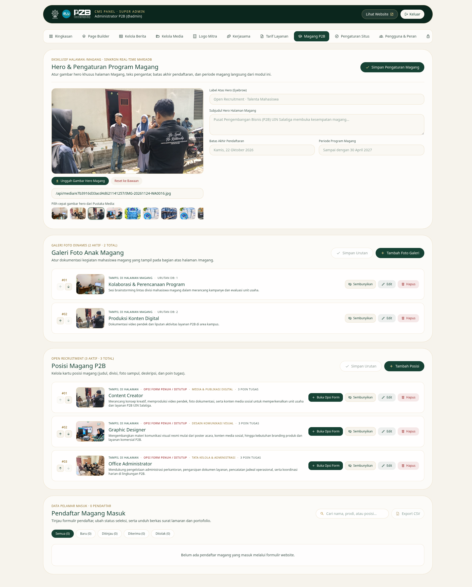
> *Gambar 13 — Tangkapan layar tab Magang P2B di `docs/images/13-cms-magang.png`.*

---

### 7.9 Tab Pengaturan Situs (`settings`)
Mengatur teks global Beranda (judul hero, subjudul, gambar hero, judul/paragraf tentang P2B) serta detail kontak resmi (`contact_phone`, `contact_whatsapp`, `contact_email`, `location_address`) yang dipakai oleh Navbar modal kontak, LocationSection, Footer, dan JSON-LD SEO.

---

### 7.10 Tab Pengguna & Peran (`users`) — Khusus Super Admin
Menggunakan **Better Auth Admin API**:
- Melihat daftar seluruh akun CMS beserta username, email, nama, peran (`Super Admin`, `Admin`, `Editor Berita`), dan status aktif/nonaktif.
- **Tambah Pengguna Baru** dengan penentuan peran secara langsung.
- **Ubah Peran Pengguna**, **Reset Password Pengguna**, **Nonaktifkan / Aktifkan Akun** (*ban/unban*), dan **Hapus Akun** (dengan proteksi agar akun sendiri tidak terhapus/ter-ban tidak sengaja).

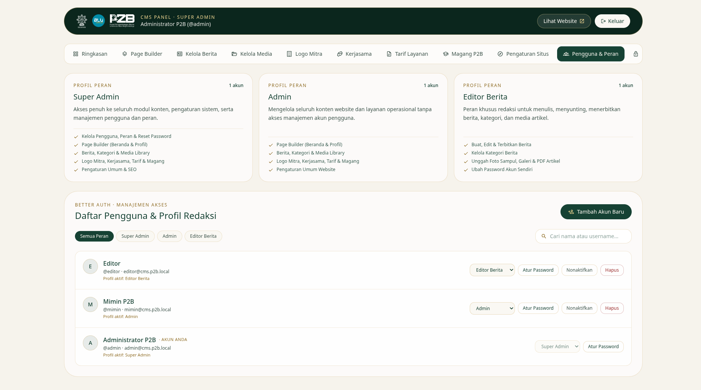
> *Gambar 14 — Tangkapan layar tab Pengguna & Peran di `docs/images/14-cms-pengguna-peran.png`.*

---

### 7.11 Tab Keamanan Akun (`security`)
Memungkinkan setiap pengguna yang sedang login (`Super Admin`, `Admin`, maupun `Editor Berita`) mengganti password akunnya sendiri dengan memasukkan password saat ini dan password baru melalui `authClient.changePassword`.

---

## 8. Referensi API Endpoints & WebSocket

### Publik & SEO
- `GET /api/public/version` — Versi perubahan konten terbaru untuk sinkronisasi klien.
- `GET /api/public/bootstrap` — Seluruh data publik awal (pengaturan, Page Builder, berita, kategori, logo, magang, tarif).
- `GET /api/public/kerjasama` — Proxy & parser CSV Google Sheets kerjasama (support header multi-baris).
- `POST /api/public/magang/apply` — Pengiriman pendaftaran magang (`multipart/form-data`: `resume`, `portfolio`).
- `GET /api/media/:id` & `GET /api/media/:id/:filename` — Penyajian gambar/PDF publik dari MariaDB.
- `GET /robots.txt` & `GET /sitemap.xml` — Konfigurasi crawler & sitemap dinamis.
- `WS /ws/realtime` — Saluran broadcast event `cms:committed`.

### Autentikasi & Setup (Better Auth)
- `ALL /api/auth/*` — Handler resmi Better Auth (`sign-in/username`, `sign-in/email`, `sign-out`, `get-session`, `change-password`, `admin/*`).
- `GET /api/auth-setup/status` — Mengecek apakah sistem membutuhkan pembuatan Super Admin perdana (`needsSetup`).
- `POST /api/auth-setup/claim` — Pendaftaran atomik akun Super Admin pertama saat database user masih kosong.

### CMS Terproteksi (Memerlukan Sesi + Izin Peran)
- `GET /api/cms/me` — Profil pengguna aktif beserta daftar izin (`permissions`).
- `PUT /api/cms/password` — Ganti password pengguna saat ini.
- `GET /api/cms/overview` — Statistik ringkas & metadata koneksi DB (`overview`).
- `GET|POST|PUT|DELETE /api/cms/news*` & `/api/cms/categories*` — CRUD berita, bulk-delete, export/import, dan kategori (`news`).
- `POST /api/cms/upload` — Unggah gambar/PDF dari editor (`news` atau `media_write`).
- `GET|PUT|DELETE /api/cms/media*` — Manajemen Media Library, export & import (`media_read` / `media_write`).
- `GET|POST|PUT|PATCH|DELETE /api/cms/home-blocks*` & `/api/cms/builder-presets*` — CRUD blok Page Builder lintas halaman, duplikasi, reorder, reset, & katalog preset (`homebuilder`).
- `GET|POST|PUT|PATCH|DELETE /api/cms/partner-logos*` — CRUD & reorder logo mitra (`logos`).
- `GET|POST|PUT|DELETE /api/cms/tarif-items*` — CRUD & reorder kategori tarif layanan dinamis (`tarif`).
- `GET|POST|PUT|PATCH|DELETE /api/cms/magang-gallery*`, `/magang-positions*`, `/magang-applications*`, `GET /api/cms/magang-files/:id` — Manajemen magang & unduh lampiran pelamar (`magang`).
- `GET|PUT /api/cms/settings` — Baca & simpan pengaturan situs, hero kerjasama, hero tarif (`settings`, `kerjasama`, `tarif`).

---

## 9. Rencana Pengembangan Ke Depan (Roadmap)

Berikut rekomendasi pengembangan bertahap untuk meningkatkan kapabilitas operasional PTN BLU, tata kelola redaksi, dan keandalan sistem:

### Fase 1 — Tata Kelola Redaksi & Keamanan Operasional (Jangka Pendek)
1. **Audit Log Aktivitas CMS**: Mencatat setiap perubahan penting (siapa yang menerbitkan berita, mengubah tarif, menghapus blok Page Builder, atau mengunduh berkas pendaftar magang) beserta timestamp di tabel `cms_audit_logs`.
2. **Alur Persetujuan Redaksi (Draft -> Review -> Publish)**: Memberi opsi agar *Editor Berita* mengajukan draft untuk ditinjau terlebih dahulu oleh *Admin/Super Admin* sebelum tayang ke publik.
3. **Penjadwalan Terbit Otomatis (*Scheduled Publishing*)**: Menambahkan kolom `published_at` pada berita sehingga rilis berita kelembagaan dapat dijadwalkan tayang otomatis pada jam tertentu.
4. **Pembatasan Rate Limiting & Proteksi Brute-Force**: Menambahkan pembatas permintaan khusus pada `/api/auth/*` dan `/api/public/magang/apply` untuk mencegah spam.

### Fase 2 — Digitalisasi Layanan & Transparansi BLU (Jangka Menengah)
1. **Sistem Booking / Reservasi Sewa Aset Online**: Kalender ketersediaan ruang (Aula, Ruang Theater, Lapangan, Ruang Rapat, dan fasilitas lainnya) yang terintegrasi pengajuan peminjaman serta estimasi biaya otomatis dari modul Tarif Layanan.
2. **Notifikasi Otomatis Pendaftar Magang (Email / WhatsApp Gateway)**: Mengirimkan pesan konfirmasi otomatis beserta kode registrasi saat mahasiswa mendaftar, dan pemberitahuan ketika status lamaran berubah menjadi *Ditinjau* / *Diterima*.
3. **Integrasi Pembayaran Non-Tunai PTN BLU (Virtual Account / QRIS)**: Mendukung penerbitan kode tagihan dan verifikasi pembayaran sewa aset atau layanan komersial lainnya secara terpusat.
4. **Dukungan Multi-Bahasa (Indonesia & Inggris)**: Penambahan switcher bahasa `ID / EN` untuk mendukung program internasionalisasi universitas dan mitra luar negeri.

### Fase 3 — Performa Infrastruktur & Otomatisasi Kualitas (Jangka Panjang)
1. **Optimasi Media Otomatis (WebP Compression & Object Storage S3/MinIO)**: Mengonversi foto upload otomatis menjadi WebP berukuran terkompresi dan memisahkan penyimpanan biner besar (`LONGBLOB`) ke Object Storage / CDN agar beban database tetap ringan.
2. **Pencarian Global & Statistik Kunjungan Internal**: Kotak pencarian terpadu (Berita, Tarif Layanan, Kerjasama, Magang) serta analitik ringan jumlah pembaca artikel dan unduhan dokumen tarif tanpa pelacak eksternal invasif.
3. **Automated Testing & CI/CD Pipeline**: Penambahan unit/integration test API (Vitest + Supertest) dan E2E test (Playwright) pada alur login RBAC, Page Builder, dan pendaftaran magang sebelum proses deployment.

---

## 10. Indeks Gambar Tutorial

Seluruh gambar tangkapan layar telah disimpan ke dalam folder `docs/images/` sesuai daftar di bawah ini dan tampil otomatis di dokumen ini:

| No | Nama Berkas Target | Konten Tangkapan Layar yang Disarankan |
| :---: | :--- | :--- |
| 01 | `docs/images/01-beranda-publik.png` | Tampilan halaman Beranda (`/`) lengkap dengan Hero dan navigasi atas |
| 02 | `docs/images/02-halaman-profil-struktur.png` | Tampilan halaman Struktur Organisasi (`/struktur-organisasi`) atau Tentang Kami |
| 03 | `docs/images/03-berita-detail.png` | Halaman detail berita (`/berita/...`) yang menampilkan artikel, galeri, & PDF |
| 04 | `docs/images/04-halaman-kerjasama.png` | Halaman `/kerjasama` menampilkan kontrol filter, sorting, & kolom ikon berkas |
| 05 | `docs/images/05-tarif-layanan-pdf-viewer.png` | Halaman `/tarif-layanan/penunjang-akademik` dengan PDF Viewer terbuka |
| 06 | `docs/images/06-halaman-magang-daftar.png` | Halaman `/magang` atau formulir pendaftaran `/magang/daftar` |
| 07 | `docs/images/07-login-cms.png` | Halaman login CMS `/silahkanmasuk` |
| 08 | `docs/images/08-cms-page-builder.png` | Tab Page Builder (`/cms`) menunjukkan daftar blok, halaman profil, & katalog |
| 09 | `docs/images/09-cms-kelola-berita.png` | Tab Kelola Berita & editor TinyMCE / kategori di CMS |
| 10 | `docs/images/10-cms-media-library.png` | Tab Media Library menampilkan grid foto/PDF & tombol salin URL |
| 11 | `docs/images/11-cms-kerjasama.png` | Tab Kerjasama CMS menampilkan form CSV Google Sheets & preview tabel |
| 12 | `docs/images/12-cms-tarif-layanan.png` | Tab Tarif Layanan CMS menampilkan daftar kategori dinamis & preview PDF |
| 13 | `docs/images/13-cms-magang.png` | Tab Magang P2B CMS menampilkan posisi/galeri & kotak masuk pelamar |
| 14 | `docs/images/14-cms-pengguna-peran.png` | Tab Pengguna & Peran (khusus Super Admin) dengan daftar role akun |
| 15 | `docs/images/15-cms-tambah-berita.png` | Form *Tambah Berita Baru* di CMS (foto sampul, editor TinyMCE, galeri, lampiran PDF, pengaturan publikasi) |

> *Catatan: Seluruh tangkapan layar di atas dihasilkan menggunakan Playwright MCP terhadap server lokal `http://localhost:3000` (halaman publik tanpa autentikasi; panel CMS menggunakan akun `admin` peran Super Admin). File gambar berada di `docs/images/` dan direferensikan langsung oleh dokumen ini.*
